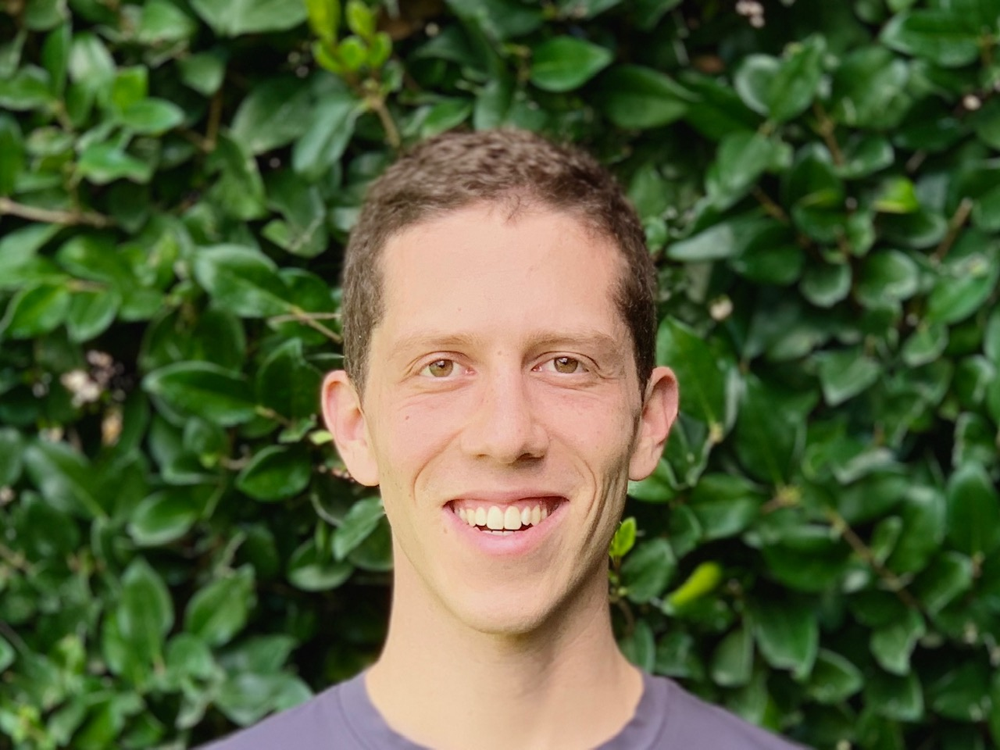

# Noam Rosenthal



I'm a PhD student at UCLA. I study exposure and vulnerability to wildfire impacts in California. This includes extreme heat, wildfire smoke PM2.5 and structural safety. I also have experience building financial products for clean energy and do so professsionally at Kettle, a wildfire reinsurer in California. 

## Publications:
- Reducing heat exposure for bus riders in Phoenix: https://www.tandfonline.com/doi/full/10.1080/23789689.2022.2029324?casa_token=2jLSwtb6dXkAAAAA%3AwvWN_btrdBG0OZfOtT-m4NAn64aSdZYaP4UhOlDliUJaU873zUQeYxa4hg4JRURVpwv3gxqSh7IDvA
- Analyzing the frequency with which heat and smoke co-occur: https://iopscience.iop.org/article/10.1088/2752-5295/ac860e/meta

## In Action:
- Google Geo for Good: https://youtu.be/znqzozZ5kvg?t=1561

### Some other projects of mine include:
1. Credit Guarantees for Renewable Energy (Stanford)
2. Resilience Wildfire Finance (Morgan Stanley)

[Link](url)
```
